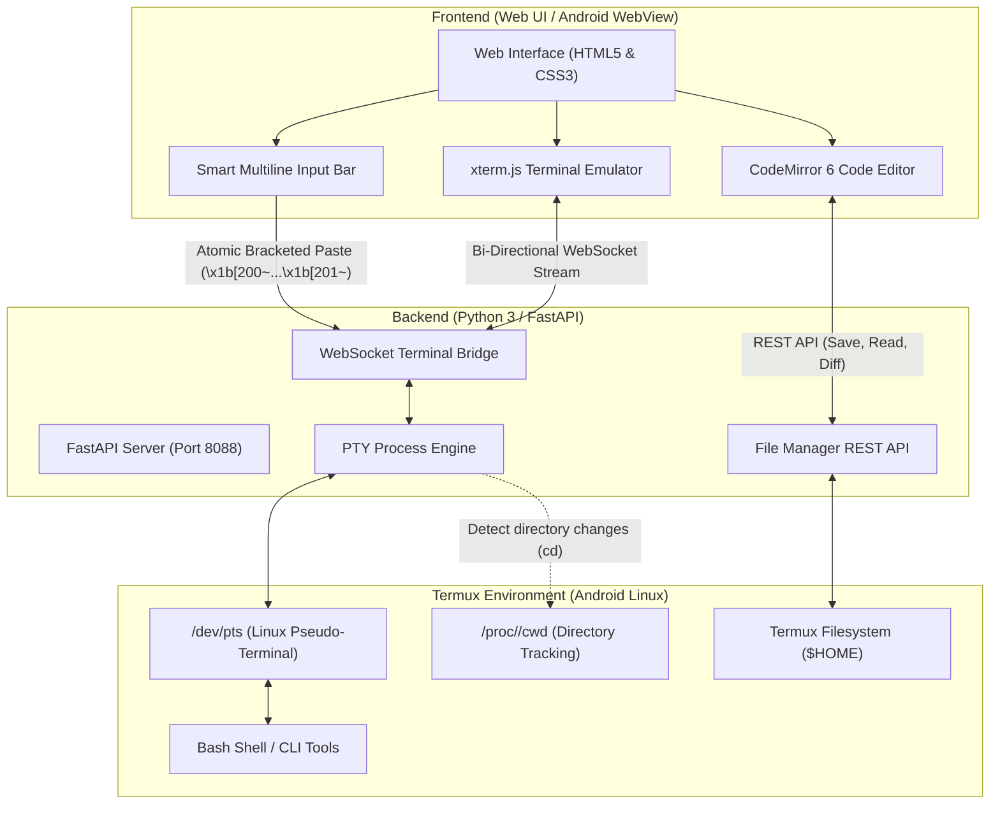

# Termux Code ⚡

<p align="center">
  <b>Modern Lightweight IDE & Native Terminal for Android via Termux</b><br>
  <i>Designed specifically for coding, editing, and running AI Agent CLIs (<code>antigravity-cli</code>, <code>claude</code>, <code>aider</code>, <code>opencode</code>) directly on Android devices.</i>
</p>

<p align="center">
  <a href="#english">English</a> •
  <a href="#bahasa-indonesia">Bahasa Indonesia</a>
</p>

<p align="center">
  <a href="https://github.com/0xposa/termux-code/releases"></a>
  <a href="LICENSE"></a>
  <a href="https://twitter.com/0xposa"></a>
</p>

---

<a name="english"></a>
## 🇬🇧 English Documentation

### 🌟 About Termux Code

**Termux Code** is an all-in-one local development environment running natively on Android via Termux. It brings together a responsive multi-language code editor (**CodeMirror 6**), a hardware-accelerated terminal emulator (**xterm.js**) connected directly to a **Linux Pseudo-Terminal (PTY)** bash shell, and an ergonomic, chat-style multiline input bar designed for touchscreens and physical keyboards.

---

### 🏗️ How It Works (Architecture)

Termux Code is built on an ultra-lightweight **Hybrid Client-Server** architecture:



#### 1. Backend Engine (Python 3 + FastAPI)
- **Linux Pseudo-Terminal (PTY) Engine (`server/pty_manager.py`):**
  Uses Python's low-level POSIX modules (`pty`, `termios`, `fcntl`, `subprocess`) to spawn a real login bash shell (`/data/data/com.termux/files/usr/bin/bash -l`). All your installed packages, PATH, aliases, Python virtualenvs, and Node.js environments are instantly available.
- **Bi-Directional WebSocket Bridge (`server/main.py`):**
  Streams raw PTY input/output with non-blocking I/O over `/ws/terminal` with near-zero latency.
- **Dynamic CWD Tracking:**
  Inspects the active process group via `/proc/<pid>/cwd` whenever commands (such as `cd`) execute, dynamically updating terminal tab titles and project explorer scope.
- **File System REST API (`server/file_manager.py`):**
  Provides endpoints for recursive file tree exploration, file read/write, uploads from Android device storage, deletion, and renaming.

#### 2. Frontend Interface (Vanilla JavaScript & Web Standards)
- **xterm.js Engine:**
  Configured with authentic ANSI compliance (`convertEol: false`) for 24-bit Truecolor rendering, cursor positioning, and full support for complex CLI retro pixel-art (such as the Antigravity CLI logo).
- **CodeMirror 6 Editor:**
  Lightweight and battery-efficient editor supporting syntax highlighting for Python, JavaScript, TypeScript, HTML, CSS, JSON, Markdown, and Bash with a custom One Dark theme.
- **Smart Multiline Chat / Command Bar:**
  Modern chat-style input box:
  - Long text wraps cleanly and auto-expands upward/downward (up to 140px) without scrolling horizontally into oblivion.
  - Supports newlines via **Shift + Enter**.
  - **Virtual Keyboard Protection:** Tapping the newline/return key (↵) on virtual keyboards (Gboard, Samsung, SwiftKey) inserts a new line without prematurely submitting the command.
  - **Atomic Bracketed Paste Mode:** Multiline payloads are wrapped in bracketed paste escape sequences (`\x1b[200~` ... `\x1b[201~`), submitting entire prompts simultaneously rather than line-by-line.

---

### ✨ Features

- 💻 **Real Native Termux Shell**: Runs on your real Termux environment with full file system permissions.
- 🔄 **Multi-Session Tabs**: Open multiple independent terminal tabs (`+`), switch between them, and close them on demand.
- ⌨️ **Mobile Virtual Key Toolbar**: Quick-access touch buttons: `ESC`, `TAB`, `CTRL`, `ALT`, `^C`, `^D`, arrow keys `↑ ↓ ← →`, `~`, `/`, `|`, `-`, `_`.
- 📎 **Path & File Attachments**: Attach file paths directly into terminal input from the project tree or upload files from your device.
- 📱 **Split-Screen & Responsive Drawer**: Draggable split pane between editor and terminal, or switch to dedicated full-screen views (*Editor Only* or *Terminal Only*).
- 🤖 **Optimized for AI Agent CLIs**: Ideal environment for `antigravity-cli`, `claude`, `aider`, `opencode`, and standard developer tools.

---

### 🚀 Installation & Getting Started

#### Prerequisites:
- Android device with **Termux** installed.
- Python 3 (`pkg install python -y`).

#### Setup:
1. **Clone the repository:**
   ```bash
   git clone https://github.com/0xposa/termux-code.git
   cd termux-code
   ```

2. **Launch the server:**
   ```bash
   chmod +x start.sh
   ./start.sh
   ```
   *The script automatically verifies and installs missing dependencies (`fastapi`, `uvicorn`, `pydantic`).*

3. **Open in Browser:**
   Navigate to your local address on your Android browser (Brave, Chrome, Firefox, etc.):  
   👉 **`http://localhost:8088`**

> [!TIP]
> Add the page to your home screen via browser settings (**"Add to Home screen"** / **"Install App"**) for a standalone, fullscreen PWA experience.

---

### 🤖 Installing AI Agents (Antigravity CLI, Claude Code, OpenCode)

Termux Code includes a dedicated, automated installer script (`install-agents.sh`) so anyone can install and set up the leading AI coding agents in Termux with a single command:

#### Interactive Menu:
```bash
chmod +x install-agents.sh
./install-agents.sh
```
This opens an easy-to-use menu where you can choose:
- `[1]` Install **Antigravity CLI** (`agy` / `antigravity-cli`)
- `[2]` Install **Claude Code** (`claude`)
- `[3]` Install **OpenCode** (`opencode`)
- `[4]` Install **ALL Agents** at once
- `[5]` Check Installed Agents Status

#### Direct Command Shortcuts:
```bash
# Install Antigravity CLI (Google Antigravity Agent)
./install-agents.sh antigravity

# Install Claude Code (Anthropic CLI Agent)
./install-agents.sh claude

# Install OpenCode (Open-Source Coding Agent)
./install-agents.sh opencode

# Install ALL three agents at once
./install-agents.sh all

# Check installation status and versions
./install-agents.sh status
```

---

### 📱 Building the Standalone Android APK

The `android/` directory contains a complete native Android Studio project wrapping the UI in a hardware-accelerated WebView:

- **Via Android Studio (PC / Laptop):**
  Open the `android/` directory and select **Build > Build Bundle(s) / APK(s) > Build APK(s)**.
- **Directly inside Termux:**
  ```bash
  pkg install openjdk-17 gradle -y
  cd android
  chmod +x build-apk.sh
  ./build-apk.sh
  ```

---

### 🌐 Community & Follow Updates

Stay connected for new releases, Android development tips, and AI agent workflows!
- **Twitter / X**: Follow [@0xposa](https://twitter.com/0xposa) (`@0xposa`) for updates and project news.
- **GitHub**: If you find Termux Code useful, please give it a star ⭐ on [GitHub](https://github.com/0xposa/termux-code)!

---

<a name="bahasa-indonesia"></a>
## 🇮🇩 Dokumentasi Bahasa Indonesia

### 🌟 Tentang Termux Code

**Termux Code** adalah lingkungan pengembangan (*IDE & Terminal*) lokal yang berjalan secara native di Android melalui Termux. Menggabungkan editor kode multi-bahasa yang hemat memori (**CodeMirror 6**), emulator terminal berbasis akselerasi hardware (**xterm.js**) yang terhubung langsung ke **Linux Pseudo-Terminal (PTY)** shell Termux asli, serta bilah input pintar (*chat-style multiline input*) yang dirancang khusus untuk kenyamanan layar sentuh HP dan keyboard fisik.

---

### 🏗️ Bagaimana Aplikasinya Bekerja?

Termux Code dibangun dengan arsitektur **Hybrid Client-Server** yang sangat ringan dan efisien:

#### 1. Sisi Backend (Python 3 + FastAPI)
- **Linux Pseudo-Terminal (PTY) Engine (`server/pty_manager.py`):**
  Menggunakan pustaka sistem Linux bawaan Python (`pty`, `termios`, `fcntl`, `subprocess`) untuk membuka saluran master/slave PTY. Shell yang dijalankan adalah shell bash Termux asli (`/data/data/com.termux/files/usr/bin/bash -l`), sehingga seluruh binary, PATH, environment variables, alias, package Python, dan Node.js Anda tersedia sepenuhnya.
- **Bi-Directional WebSocket Bridge (`server/main.py`):**
  Endpoint `/ws/terminal` membaca output PTY secara non-blocking dan mengalirkannya secara *real-time* ke browser via WebSocket dengan latensi sangat rendah.
- **Dynamic CWD Tracking:**
  Sistem secara berkala dan reaktif memeriksa direktori kerja proses shell (`/proc/<pid>/cwd`) setiap kali perintah seperti `cd` dijalankan, sehingga judul tab terminal dan scope file explorer selalu sinkron dengan direktori yang sedang dibuka.
- **File Manager API (`server/file_manager.py`):**
  Menyediakan endpoint RESTful untuk membaca hierarki folder (*file tree*), membaca/menyimpan konten file, membuat berkas/folder baru, upload berkas dari device Android, mengganti nama (*rename*), dan menghapus file secara aman.

#### 2. Sisi Frontend (Vanilla JavaScript + Web Standards)
- **xterm.js Terminal:**
  Menggunakan `xterm.js` dengan konfigurasi ANSI PTY yang presisi (`convertEol: false`) untuk mendukung rendering warna Truecolor 24-bit, styling teks CLI, dan grafik TUI/pixel art yang akurat (seperti logo Antigravity CLI).
- **CodeMirror 6 Editor:**
  Editor kode modern yang di-bundle menggunakan esbuild, mendukung *syntax highlighting* untuk Python, JavaScript, TypeScript, HTML, CSS, JSON, Markdown, dan Bash dengan tema One Dark yang nyaman di mata.
- **Smart Multiline Input / Chat Bar:**
  Kolom perintah di bagian bawah dirancang layaknya aplikasi chat modern (WhatsApp / ChatGPT):
  - Teks panjang otomatis membungkus ke bawah (*word wrap*) dan tinggi kolom membesar secara otomatis (*auto-expand* hingga 140px).
  - Mendukung baris baru dengan **Shift + Enter**.
  - **Proteksi Keyboard Virtual:** Menekan tombol baris baru (↵) pada keyboard virtual HP (Gboard, Samsung, dll.) tidak akan mengirim pesan sebelum tombol **Kirim** ditekan.
  - **Atomic Bracketed Paste Mode:** Teks multi-baris dikirim ke terminal menggunakan protokol *Bracketed Paste* (`\x1b[200~` ... `\x1b[201~`), memastikan seluruh kalimat terkirim secara bersamaan tanpa terpotong atau dieksekusi per baris.

---

### ✨ Fitur Unggulan

- 💻 **Real Native Termux Shell**: Berjalan di lingkungan Termux asli dengan izin akses berkas penuh.
- 🔄 **Multi-Session Tabs**: Buka banyak tab terminal secara bersamaan (`+`), ganti nama sesi, dan tutup sesi dengan mudah.
- ⌨️ **Mobile Virtual Key Toolbar**: Bilah tombol praktis untuk navigasi di HP: `ESC`, `TAB`, `CTRL`, `ALT`, `^C`, `^D`, tombol panah `↑ ↓ ← →`, `~`, `/`, `|`, `-`, `_`.
- 📎 **File Attachment Dropdown**: Sisipkan path file langsung ke terminal, baik dari berkas proyek yang sedang aktif maupun upload langsung dari penyimpanan perangkat.
- 📱 **Split-Screen & Responsive Drawer**: Tampilan split editor dan terminal yang bisa digeser ukurannya (*panel resizer*), atau beralih ke mode fokus: *Editor Only* atau *Terminal Only*.
- 🤖 **Cocok untuk AI Agent CLIs**: Optimal untuk menjalankan CLI seperti `antigravity-cli`, `claude`, `aider`, `opencode`, dan alat CLI lainnya.

---

### 🚀 Cara Instalasi & Menjalankan

#### Persyaratan:
- Perangkat Android dengan aplikasi **Termux** terpasang.
- Python 3 (`pkg install python -y`).

#### Langkah-langkah:
1. **Clone repository ini:**
   ```bash
   git clone https://github.com/0xposa/termux-code.git
   cd termux-code
   ```

2. **Jalankan aplikasi:**
   ```bash
   chmod +x start.sh
   ./start.sh
   ```
   *Skrip `start.sh` akan secara otomatis memeriksa dan menginstal dependensi Python (`fastapi`, `uvicorn`, `pydantic`) yang diperlukan.*

3. **Buka di Browser:**
   Akses antarmuka web melalui browser HP Anda (Brave, Chrome, Firefox, dll.):  
   👉 **`http://localhost:8088`**

> [!TIP]
> Untuk pengalaman aplikasi layar penuh (*fullscreen app*), Anda bisa memilih opsi **"Add to Home screen"** / **"Install app"** di menu browser Android Anda (PWA ready).

---

### 🤖 Panduan Instalasi AI Agent (Antigravity CLI, Claude Code, OpenCode)

Termux Code telah menyertakan skrip installer otomatis (`install-agents.sh`) agar siapa saja dapat memasang dan mengonfigurasi AI Agent CLI terpopuler di Termux dengan satu perintah mudah:

#### Menggunakan Menu Interaktif:
```bash
chmod +x install-agents.sh
./install-agents.sh
```
Perintah ini akan membuka menu interaktif:
- `[1]` Pasang **Antigravity CLI** (`agy` / `antigravity-cli` dari Google)
- `[2]` Pasang **Claude Code** (`claude` dari Anthropic)
- `[3]` Pasang **OpenCode** (`opencode` AI Coding Agent)
- `[4]` Pasang **SEMUA Agent** sekaligus
- `[5]` Cek Status & Versi Agent yang Terpasang

#### Perintah Cepat (One-Liner):
```bash
# Pasang Antigravity CLI
./install-agents.sh antigravity

# Pasang Claude Code
./install-agents.sh claude

# Pasang OpenCode
./install-agents.sh opencode

# Pasang SEMUA agent sekaligus
./install-agents.sh all

# Cek status dan versi yang sudah terpasang
./install-agents.sh status
```

---

### 📱 Membangun Aplikasi Android Standalone (APK)

Termux Code juga menyertakan proyek Android Studio lengkap di folder `android/`:

- **Di PC/Laptop (Android Studio):**
  Buka folder `android/` di Android Studio, lalu lakukan **Build > Build Bundle(s) / APK(s) > Build APK(s)**.
- **Langsung di Termux:**
  ```bash
  pkg install openjdk-17 gradle -y
  cd android
  chmod +x build-apk.sh
  ./build-apk.sh
  ```

---

### 🌐 Komunitas & Ikuti Pembuat

Dapatkan pembaruan rilis terbaru, tips seputar Termux, dan alur kerja AI agent!
- **Twitter / X**: Ikuti [@0xposa](https://twitter.com/0xposa) (`@0xposa`) untuk kabar proyek dan diskusi.
- **GitHub**: Jika Anda merasa Termux Code bermanfaat, jangan lupa berikan bintang ⭐ di [GitHub](https://github.com/0xposa/termux-code)!

---

## 📁 Struktur Direktori / Directory Structure

```text
termux-code/
├── android/                   # Android Studio Native Project (WebView Wrapper)
│   ├── app/
│   │   ├── src/main/java/     # MainActivity (WebView controller)
│   │   ├── src/main/assets/   # Bundled offline web assets
│   │   └── build.gradle.kts   # Gradle configuration
│   └── build-apk.sh           # APK builder script
├── server/                    # Python Backend
│   ├── main.py                # FastAPI server & WebSocket bridge
│   ├── pty_manager.py         # Linux PTY engine & CWD process inspector
│   └── file_manager.py        # REST API for file operations
├── web/                       # Frontend Web UI
│   ├── index.html             # Main HTML layout
│   ├── styles.css             # One Dark theme & mobile responsive CSS
│   ├── app.js                 # App core, WebSocket, & terminal controller
│   └── vendor/                # Bundled xterm.js & CodeMirror 6
├── tests/                     # Backend Unit Tests
│   └── test_backend.py        # PTY, File CRUD, & Endpoint tests
├── .gitignore                 # Git ignore rules
├── install-agents.sh          # All-in-one AI Agent CLI automated installer
├── package.json               # CodeMirror bundler configuration
├── start.sh                   # One-click startup launcher
└── README.md                  # Comprehensive Documentation
```

---

## 🧪 Testing

Jalankan pengujian unit test backend / Run backend unit tests:

```bash
python3 -m unittest discover tests
```

---

## 👤 Author & Community / Pembuat & Komunitas

<p align="center">
  Crafted with ❤️ by <b>0xposa</b><br>
  Follow for updates, Android dev tips, and AI agent guides:<br><br>
  <a href="https://twitter.com/0xposa">
    
  </a>
</p>

---

## 📄 Lisensi / License

This project is licensed under the **MIT License** - see the [`LICENSE`](LICENSE) file for details.  
Proyek ini dilisensikan di bawah **Lisensi MIT** - lihat berkas [`LICENSE`](LICENSE) untuk informasi selengkapnya.
